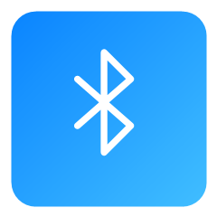

# WinLandPlugin · WinIsland 社区插件市场

WinIsland（Windows 11 灵动岛）的社区插件仓库。

WinIsland 的「设置 → 插件市场」只请求本仓库根目录的 **[index.json](./index.json)**：插件列表、版本、图标
（内嵌 PNG）全在这一个文件里，整个列表**只发一次请求**；只有点「安装」时才下载对应的 `.lwp` 并校验 SHA-256。

清单由 GitHub Action 自动生成，**请勿手改 `index.json` 和下面的表格**。

## 插件清单

<!-- PLUGINS:START -->
| 图标 | 插件（Id） | 版本 | 作者 | 说明 |
| :---: | :--- | :---: | :--- | :--- |
|  | **Clash 小岛**<br/>`clash-verge-island` | 2.0.2 | hit | 小岛显示 Clash Verge 当前节点和延迟（国旗按真实出口 IP 识别），展开后可在岛上直接换节点、切模式、切场景、更新订阅，点一下弹出大卡片：节点列表、按地区筛选、谁在用流量、今日与本月流量统计。自动读取 Clash Verge 的连接参数，只需在它里面打开「外部控制」。 |
|  | **Everything搜索**<br/>`everything-search` | 1.2.1 | jingy | 把 Everything 装进任务栏岛：点一下弹出搜索卡片，输入即搜、实时出结果，回车打开、Ctrl+回车定位。跟随岛体明暗配色。 |
|  | **FlClash 小岛**<br/>`flclash-island` | 1.6.0 | Thesed | 为 FlClash 提供国旗、实时网速曲线、岛内节点切换和单节点延迟测试，内置首次使用引导。 |
|  | **Token 计岛**<br/>`token-meter` | 1.1.0 | KujouShiori | 实时显示token用量与费用、今日花费与明细、能展开近7天趋势。默认只读本机会话日志；可选启用服务商用量接口（密钥走环境变量，接口挂了自动降级回本地日志）。 |
|  | **Windows 原生通知**<br/>`native-notifications` | 0.5.0 | Timi | 把 Windows 系统通知搬到灵动岛：简要条提醒新消息，悬停查看按应用分组的通知列表，清除时同步删除系统通知中心的记录。 |
|  | **剪贴板岛**<br/>`clipboard-island` | 1.2.1 | luolangaga | 复制文字或图片时岛上弹提示；展开就是最近几条历史，点任意一条直接粘进你正在输入的窗口 |
|  | **天气小岛**<br/>`weather-island` | 1.2.1 | luolan | 小岛显示当前温度，展开看三天预报，点一下弹出大卡片：实况细节、24 小时逐时、7 天预报、日出日落与空气质量。配色与天气图标跟随岛体明暗，数据来自 Open-Meteo，不用注册也不用填密钥。 |
|  | **媒体播放**<br/>`media-playback` | 1.0.8 | Thesed | 独立媒体小部件：双行同步歌词、随音乐闪动的柔和光束和系统媒体播放控制。 |
|  | **开机时长**<br/>`uptime-clock` | 1.0.0 | zlwzk | 圆圈进度展示开机时长（24 小时一圈），展开显示 CPU 温度与开机记录 |
|  | **时钟岛**<br/>`pomodoro-island` | 1.0.0 | hitikem | 灵动岛上的番茄钟 + 随手倒计时：会漏沙会翻转的矢量沙漏，点击岛体打开白色控制台，自动记录今日完成情况。 |
|  | **电量与音量**<br/>`bluetooth-battery` | 1.1.0 | zouyingfeng | 在灵动岛上显示已连接蓝牙设备的电量与系统音量；点岛体查看全部设备、音量并可手动刷新。 |
|  | **硬件监控**<br/>`hw-monitor` | 1.0.3 | WinIsland | 常驻硬件信息：小岛显示 CPU/GPU/网络/帧率，大岛显示前台窗口 FPS、CPU、GPU 与上下传速度 |
|  | **设备插拔岛**<br/>`device-island` | 1.0.0 | luolangaga | 插 U 盘 / 耳机 / 手柄时岛上自动冒出；展开逐台列出当前设备，带「打开」「安全弹出」 |
<!-- PLUGINS:END -->

## 目录结构

```
WinLandPlugin/
├── index.json                  ← 自动生成：客户端唯一数据源（含 sha256 / 体积 / 内嵌图标）
├── README.md                   ← 本文件（插件表格也由 Action 更新）
├── CONTRIBUTING.md             ← 投稿规范
├── tools/
│   ├── build-index.ps1         ← 扫描 plugins/ 生成 index.json + README 表格
│   └── submit-plugin.ps1       ← 作者本地打包 + 校验（一条命令产出待提交目录）
└── plugins/
    └── hw-monitor/             ← 一个插件一个目录，目录名 = 插件 id
        ├── plugin.json         ← 清单（元数据来源，必须与包内那份一致）
        ├── hw-monitor.lwp      ← 插件包（zip 格式，扩展名 .lwp）
        ├── logo.png            ← 可选，建议 240×240 透明 PNG
        └── README.md           ← 可选，详情页展示的说明
```

## 装插件

1. 打开 WinIsland → 设置 → **插件市场**，列表来自本仓库的 `index.json`；
2. 点「安装」→ 客户端下载 `.lwp`、校验 SHA-256、安装并启用；
3. 「详情」里有完整说明、许可证、主页与包哈希；启用/禁用/删除在「插件管理」。

## 市场源与镜像

**GitHub 是唯一源头**（投稿、Issue、Action 都在这边），下面几个地址只是分发用的镜像。
客户端默认按顺序尝试、命中即停，并记住上次成功的源；也可以在「插件市场 → 市场源」里手动指定：

| 源 | 地址 | 说明 |
| :--- | :--- | :--- |
| GitHub 官方 | `https://raw.githubusercontent.com/luolangaga/WinLandPlugin/main` | 内容最新；部分国内网络解析不了该域名 |
| **GitCode 国内镜像** | `https://api.gitcode.com/api/v5/repos/luolangaga/WinLandPlugin/raw` | <https://gitcode.com/luolangaga/WinLandPlugin> 自动同步本仓库，国内访问快 |
| jsDelivr CDN | `https://cdn.jsdelivr.net/gh/luolangaga/WinLandPlugin@main` | 海外 CDN，分支内容有缓存（更新会延迟） |
| jsDelivr 备用域 | `https://gcore.jsdelivr.net/gh/luolangaga/WinLandPlugin@main` | 同上，`cdn` 域不通时使用 |

路径拼接规则一致：`<源>/index.json`、`<源>/plugins/<id>/<id>.lwp`。

## 投稿插件

见 **[CONTRIBUTING.md](./CONTRIBUTING.md)**。最简流程：

1. 按 WinIsland 插件开发指南（`PLUGIN.md`，SDK 2.0）写好插件并打包成 `.lwp`；
2. `pwsh tools/submit-plugin.ps1 -SourceDir <构建输出目录> -Logo logo.png` 生成 `plugins/<id>/`；
3. Fork 本仓库 → 分支 `add-plugin-<id>` → 提交该目录 → 开 PR。

PR 合并后 Action 会自动重建 `index.json` 与本文件的插件表格，客户端刷新即可看到。

## index.json 格式（schema 1）

| 字段 | 说明 |
|------|------|
| `schema` | 清单格式版本，当前为 `1` |
| `repo` / `updated` / `count` | 仓库名 / 生成时间 / 插件数量 |
| `plugins[]` | 插件条目数组，见下表 |

单条插件：

| 字段 | 说明 |
|------|------|
| `id` | 插件 Id，与目录名、`plugin.json` 一致 |
| `name` / `version` / `description` / `author` | 展示信息 |
| `icon_glyph` | 没有 logo 时的 Segoe 图标字形 |
| `homepage` / `license` / `tags` | 主页 / 许可证 / 标签 |
| `api_version` / `min_host_version` | 兼容性要求，客户端据此禁用不兼容的插件 |
| `package` | 包在仓库内的相对路径 |
| `package_size` / `sha256` | 包大小与哈希，下载后强制校验 |
| `readme` | 说明文件相对路径（详情页按需拉取，列表阶段不请求） |
| `logo` | 原图路径（供浏览器查看） |
| `logo_data` | `data:image/png;base64,…` 缩略图标，随清单一次下发，避免逐插件请求 |
| `updated_at` | 该插件目录最后一次提交时间 |

## 许可

本仓库自身的脚本与文档为 MIT；每个插件的许可见其 `plugin.json` 的 `license` 字段。
